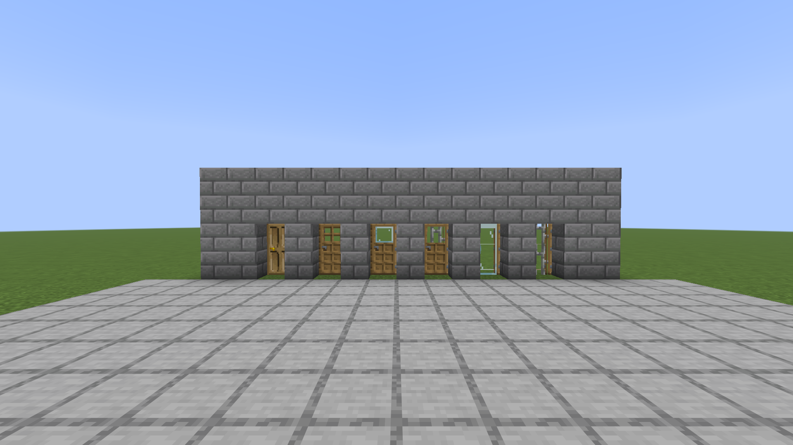
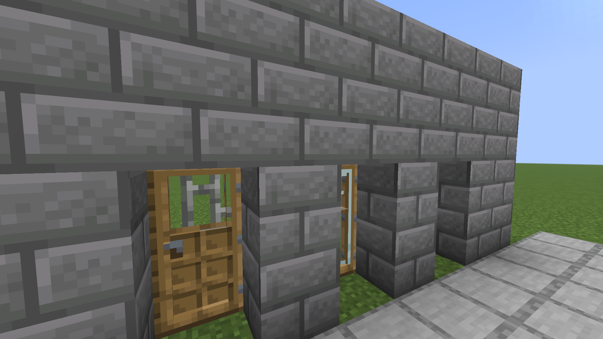

# Moredoor

Doors with depth, doors that lock, doors that swing together, and the same six variants for every wood in the game.

## Screenshots

## Six Doors Per Wood

Every wood (oak, spruce, birch, jungle, acacia, dark oak, mangrove, cherry, pale oak, bamboo, crimson, warped and poplar) offers six doors and four trapdoors. Iron and copper doors are left as they are.

| variant | shape | door recipe (3 doors) | trapdoor recipe (2 trapdoors) |
| --- | --- | --- | --- |
| **solid** | dark oak's four panels, in this wood | 6 planks, 2 wide and 3 high | 6 planks, 3 wide and 2 high |
| **classic** | oak and iron's windowed shape | the same with the middle-left plank left out | the same with the bottom-middle plank left out |
| **glass** | one window, glazed | the classic layout, a glass pane in the gap | the classic layout, a glass pane in the gap |
| **barred** | one window, barred | the classic layout, iron bars in the gap | the classic layout, iron bars in the gap |
| **full glass** | glazed the whole way down | 3 planks in one column, 3 glass panes in the other | - |
| **full barred** | barred the whole way down | 3 planks in one column, 3 iron bars in the other | - |

**Solid is the default**: the plain six-plank recipe makes the solid door and trapdoor in place of vanilla's. The wood's vanilla door and trapdoor are still there: a stonecutter turns any one of a wood's solid, classic and vanilla door into the others, one for one, and the same for its trapdoors.

Where a wood already owns a shape it keeps it exactly: dark oak's solid door and oak's classic door are the vanilla blocks to the pixel.

**A solid door keeps the light out.** A shut solid door or trapdoor stops light through the face it covers, the way a slab does through its half. Vanilla's doors, iron included, let light through, and so does every variant here with an opening in it.

## Doors Are Not Flat

Every door is drawn with depth: a frame standing proud of a recessed panel, and a handle that sticks out far enough to cast a shadow. That covers vanilla's twenty-two doors as well as the seventy-eight here, and a resource pack that retextures doors still retextures all of them.

## Locked Doors

Right-click any door with an iron ingot to lock it, the ingot spent. Nothing about it looks different; it opens for its owner and nobody else.

The lock button on the door's menu (sneak and right-click it with an empty hand) does the same for free and goes round three states: **Unlocked**, **Locked**, and **Open to everyone**, where anybody can walk through. Only the owner and operators can change the lock.

Only the owner, players they have let in, and operators can break, turn or re-hang a locked door, open to everyone or not. The owner lets others in by looking at the door and using `/doors allow` or `/doors deny` (see Commands). Operators are always let through and can use the commands on anybody's door.

**A door locks as a whole**: every leaf that opens with the one locked is locked with it.

## A Door Is Made Of Squares

The controls:

- **Place a door against another** and it takes that door's facing and hinge, so a door grows the way it was started.
- **Sneak while placing** and it hangs the way vanilla would hang it, which beside one door is on the other side: a double door, two leaves meeting in the middle.
- **Sneak and place a door on top of another** and it stands there, so a door can be taller than two blocks.
- **Sneak and right-click a door with an empty hand** to open its menu: how it hangs, how it slides, joining and cutting loose, and the lock.
- **Sneak and right-click a door with an axe** to turn it in place: hinge first, then facing, eight clicks back to the start. Iron doors take a pickaxe. A locked door turns only for its owner.
- `/doors hang` re-hangs a door from the command line (operators; see Commands).

Doors of one kind, hung on the same side and filling a rectangle, are one door whatever its size. A leaf that breaks the rectangle (one missing from a corner, one hung the other way) is a door of its own.

### The menu

The top row is the block seen from above with you at the bottom of it: a leaf along the near edge or the far one, hung from its left corner or its right. The bottom row is a leaf sliding left, right, up or down, and one more button that moves the door to the other face of its block. The lit picture is how it hangs now, and the choice is for the whole door.

Two more buttons appear when other leaves stand against the one clicked:

- **Disconnect** cuts this leaf loose: it becomes a door of its own and clicks on its neighbours no longer reach it. A double door does not need it.
- **Autoconnect** takes every leaf standing together there that is not part of this door (cut loose, hung another way, facing the other way, turned a quarter round), closes it, hangs it the way the biggest door among them hangs and joins them into one door, if together they make a rectangle.

Doors hang from a side. Hanging from the top or bottom is what a trapdoor is for.

### How they move

**Sliding doors** go along their own plane by their own size: sideways like a barn door, up like a shutter, or down into the floor. The space they slide into must be clear, so a door set into a doorway with wall all round cannot slide; hang it on the face of the wall, or leave it a pocket. A slide with nowhere to go stays put and says "Nothing to slide into". A slid door is drawn and walked through exactly as a closed one standing there.

**A wide door swings as a door.** It hangs from its hinge column, and every other leaf moves to the block it really sweeps to, the same distance out from the hinge as it stood along the wall. Collision, light and the way through all match what is drawn. It goes a column at a time from the hinge, outermost back first, and a sliding door a block at a time, so a bigger door takes longer. A door that swings into something goes as far as that, knocks, sheds dust and closes again. A door one leaf wide swings in place like vanilla's.

**Doors side by side open together**: touching, in the same line and in the same block. A row of them is a gatehouse. A pair built from opposite sides of the same doorway faces two ways and still opens as one; a door in the wall at right angles is a door of its own. The leaf you click makes the sound and the rest come quietly. An iron door beside a wooden one does not open with it.

**Redstone reaches the whole door.** A signal at any square opens or closes all of it. A leaf that has moved away from its lever cannot hear it switch off, so power a door at the hinge column, which stays put, or take the signal to where the door is when open.

**Drawn as one door.** The frame goes round the outside of the rectangle with one handle, at the swinging edge of the bottom row, and the panels repeat across the inside, so a two-by-two bank of oak doors reads as one tall wide oak door rather than four small ones.

## Trapdoors

Trapdoors of one kind lying at the same height, or standing open against the same wall, and filling a rectangle, are drawn as one hatch or one shutter: frame round the outside, panel stretched across the inside. Lay them and they join.

They open together too, with one sound: trapdoors of one kind, touching, at the same half of their blocks and hung across the same gap. A pair of cellar doors meeting in the middle opens as one hatch. Iron trapdoors still need redstone.

**Sneak and right-click a trapdoor with an empty hand** to re-hang it: which edge it hinges from (near, far, left or right, as you see it with the near edge at your feet) and whether it sits at the top or bottom of its block. The choice is for the whole hatch, closed, and reaches only the trapdoors hung the same way. **Autoconnect** on the same menu hangs every trapdoor touching this one the way this one hangs, so they open as one hatch.

## Doors Connect To Fences

Fences connect to doors, so a fence line runs right up to a door with no post standing alone beside it. Where a fence meets a door the door gets a jamb, a post and two short rails in the door's wood, as tall as the fence: a fence one high jambs the lower half, a fence stacked two high jambs both. Pandorical clients see the jamb; vanilla clients see a small gap.

## Large Gates

Fence gates side by side, or stacked, are one gate: use any of it and the whole gate opens, away from you the way a single gate does. Shut, a row is drawn as one wide gate and a stack as one tall gate.

A gate more than one wide opens the way the large doors do: its blocks really swing out, so the open leaf is solid and can be clicked to shut the gate. A block where the leaf would land stops it with a knock, and one in the arc sends it back. A row longer than 17 opens as several gates side by side.

**Sneak and right-click a gate with an empty hand** to choose one leaf from the left post, one from the right, or two meeting in the middle, left and right as you see them. The whole gate is hung at once, and a gate placed against one takes its hinge. Shut a wide gate before re-hanging it.

## Commands

The first three act on the door you are looking at, within 6 blocks.

| command | who | does |
| --- | --- | --- |
| `/doors allow <player>` | owner, operators | lets that player through a locked door |
| `/doors deny <player>` | owner, operators | takes that back |
| `/doors unlock` | owner, operators | removes the lock |
| `/doors hang <pos> <swing>` | operators | hangs the whole door at that position; swing is `left`, `right`, `slide_left`, `slide_right`, `slide_up` or `slide_down` |

With Pandorical's action menus, a "Door" menu offers Unlock, Let in and Keep out as buttons.

## Pandorical

Moredoor goes on the server only, and **Pandorical is required there and on every player's client**: the door and trapdoor variants are new blocks, and a client without Pandorical has no entry for them. Pandorical also draws the depth, the joined doors, hatches and gates, and the jambs, and opens the sneak right-click menus for doors, trapdoors and gates.

## Development

Installing and the art pipeline are in [DEVELOPMENT.md](DEVELOPMENT.md).

## License

MIT, see [LICENSE](LICENSE).
